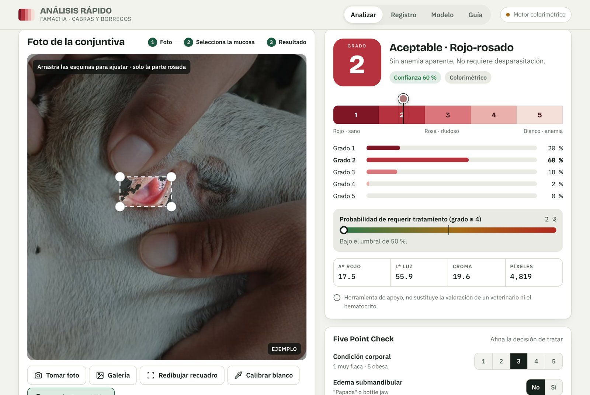

# Análisis Rápido FAMACHA

Página web y red neuronal para estimar el **grado FAMACHA© (1–5)** y la decisión **tratar / no tratar** en cabras y borregos a partir de una foto de la conjuntiva del párpado inferior.



| Componente | Qué hace | Estado |
|---|---|---|
| **Página web** (`web/`) | Tomar o subir la foto, marcar la mucosa, ver el grado, Five Point Check, registro de muestras y exportación del dataset | Funciona sin entrenar nada |
| **Motor colorimétrico** | Mide el color de la mucosa en CIELAB y lo ubica en la escala FAMACHA con un modelo ordinal; se recalibra con cada foto etiquetada | Activo por defecto |
| **FAMACHA-Net** (`famacha/`, `scripts/`) | CNN EfficientNetV2-B0 (preentrenada en ImageNet) + estadísticas de color + datos clínicos → regresión ordinal CORAL | Se activa sola en la página cuando la entrenas |
| **Importador de Roboflow** | Convierte datasets públicos de conjuntiva al formato de entrenamiento | Listo |

> **Aviso.** Es una herramienta de apoyo. No sustituye la valoración de un veterinario ni el hematocrito (PCV). Los umbrales del motor colorimétrico son aproximados hasta que lo calibres con fotos evaluadas por una persona capacitada.

---

## 1. Inicio rápido (en tu computadora)

Requisitos: Python 3.10–3.13 y Chrome, Edge o Firefox recientes.

```bash
git clone https://github.com/<tu-usuario>/famacha-analisis-rapido.git
cd famacha-analisis-rapido
python -m venv .venv
# Windows: .venv\Scripts\activate      macOS/Linux: source .venv/bin/activate
pip install -r requirements.txt

python serve.py          # abre http://localhost:8000
```

Solo para usar la página no hace falta instalar nada: `serve.py` usa la biblioteca estándar de Python. TensorFlow.js viene incluido en `web/vendor/`, así que la página funciona sin internet. Las muestras del Registro se guardan en tu navegador.

## 2. Activar la red neuronal

La red se entrena con fotos **etiquetadas por una persona con la tarjeta FAMACHA**. Elige una fuente:

**A. Tus propias fotos (lo recomendado).** Usa la página: analiza, pulsa *Guardar en el registro* y anota el grado del evaluador (y el PCV si lo tienes). Luego, en *Registro → Exportar dataset (.zip)*, descomprime el archivo en `data/`:

```bash
python run_pipeline.py --labels data/famacha_dataset/labels.csv --quick
python serve.py
```

**B. Un dataset público de Roboflow Universe.** Busca en [universe.roboflow.com](https://universe.roboflow.com/search?q=famacha) un proyecto cuyas clases sean grados FAMACHA (por ejemplo `Score_1 … Score_5`). Revisa su licencia y descárgalo en formato **YOLOv8** o **Folder**:

```bash
pip install roboflow
python scripts/import_roboflow.py --api-key TU_KEY --workspace WS --project PROYECTO --version 1 --format yolov8
#   o, si bajaste el .zip desde la web:
python scripts/import_roboflow.py --from-dir data/mi_export_roboflow
#   si las clases no traen el número de grado:  --map "rojo=1,rosa=3,blanco=5"

python run_pipeline.py --labels data/mi_export_roboflow/labels.csv --quick
python serve.py
```

**C. Solo probar la integración.** Esto genera imágenes sintéticas: la red resultante **no sirve para diagnosticar** y la página lo marca como DEMO.

```bash
python run_pipeline.py --demo
```

`run_pipeline.py` hace todo en orden: preparar → entrenar → evaluar → Grad-CAM → exportar a TF.js → copiar a `web/model/`. Usa `--quick` en CPU (1 fold, menos épocas). Sin `--quick` hace validación cruzada de 5 folds; para eso conviene una GPU (Google Colab sirve).

Para exportar a la web hace falta el convertidor:

```bash
pip install --no-deps tensorflowjs==4.22.0 && pip install tensorflow-hub
```

Se instala con `--no-deps` porque sus dependencias opcionales (jax, tensorflow-decision-forests) suelen chocar con TensorFlow. `scripts/export_tfjs.py` las sustituye automáticamente si faltan.

## 3. Qué tan confiable es

- **Nadie puede prometer un 98 % en los 5 grados.** La etiqueta es visual y dos evaluadores capacitados suelen diferir en un grado. Reporta la exactitud ±1 grado, la kappa cuadrática y la decisión tratar/no tratar, y compara contra el PCV cuando puedas.
- El entrenamiento separa entrenamiento y prueba **por animal**, para que el mismo animal nunca quede en ambos lados. Los datasets de Roboflow no traen el ID del animal: se agrupa por foto original y la cifra puede salir optimista.
- `runs/<experimento>/` guarda `report_test.json` (con IC 95 % por bootstrap), la matriz de confusión y el Grad-CAM. Revisa en el Grad-CAM que la red mire la mucosa y no los dedos.
- Un modelo entrenado con fotos de otra región, raza o teléfono puede fallar con tus animales. Valídalo con fotos tuyas: `python scripts/evaluate.py --run runs/<exp> --csv data/<tuyas>/processed/processed.csv`.

Detalles de diseño, protocolo de captura y métricas: [`docs/METODOLOGIA.md`](docs/METODOLOGIA.md).

## 4. Estructura

```
├── web/                 Página (index.html autocontenido), TF.js incluido, web/model/ ← red exportada
├── famacha/             Paquete: capas (balance de blancos, color, CORAL), modelo, datos, métricas
├── scripts/             prepare · train · evaluate · gradcam · predict · export_tflite · export_tfjs · import_roboflow · make_synthetic
├── run_pipeline.py      Todo en un comando
├── serve.py             Servidor local de la página
├── config.yaml          Hiperparámetros
└── data/                Tus datasets (ignorado por git)
```

## 5. Subir a GitHub

```bash
git init && git add . && git commit -m "Análisis Rápido FAMACHA"
git branch -M main
git remote add origin https://github.com/<tu-usuario>/famacha-analisis-rapido.git
git push -u origin main
```

`data/` y `runs/` están en `.gitignore`. Si quieres que la red entrenada viaje con el repo, sube `web/model/` (unos 12 MB).

**GitHub Pages (opcional).** En *Settings → Pages* elige la rama `main` y la carpeta `/ (root)`; la página quedará en `https://<tu-usuario>.github.io/famacha-analisis-rapido/web/`. Todo lo que esté en `web/model/` quedará público.

## Créditos

- EfficientNetV2-B0 con pesos ImageNet de [Keras Applications](https://keras.io/api/applications/).
- [TensorFlow.js](https://github.com/tensorflow/tfjs) 4.22.0 (Apache 2.0).
- Regresión ordinal CORAL: Cao, Mirjalili & Raschka (2020).
- Sistema FAMACHA©: Bath, Malan & van Wyk. La página usa colores ilustrativos y no reproduce la tarjeta oficial.
- Five Point Check©: Bath & van Wyk (2009).
